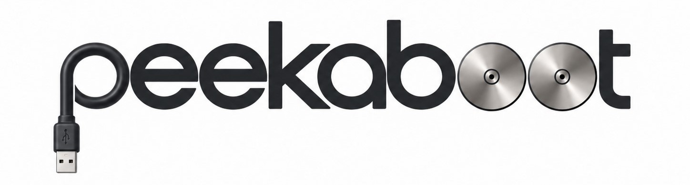
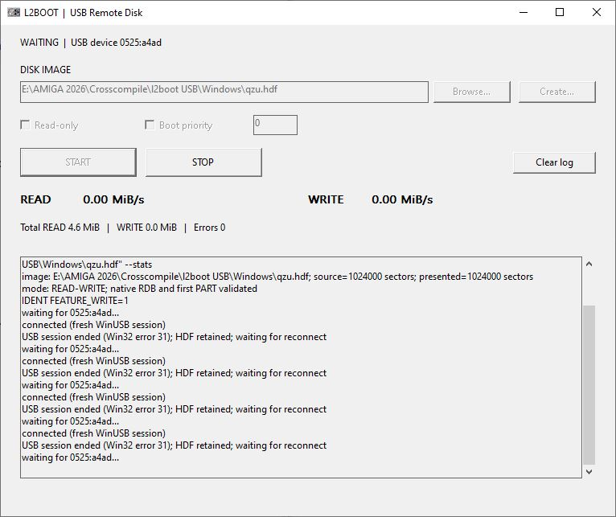

<p align="center">
  
</p>

## AI CODED

peekaboot lets an Amiga boot from, or access, an HDF disk image stored on a Windows PC through USB. The disk appears as `l2scsi.device`, unit `0`. No Amiga TCP/IP or USB stack is needed.

**Hardware-validated configuration:** Amiga 600 + PiStorm Classic + Emu68 1.1 + Raspberry Pi 3A+.

## 1. Requirements

- The hardware configuration above and a working USB data connection to a Windows PC.
- The Windows companion executable (`rdisk_host_winusb.exe`); optionally, the Windows GUI (`peekaboot.exe`).
- An HDF containing a valid Amiga RDB and a bootable AmigaOS partition if USB boot is required.
- Matching prebuilt Amiga files: `ptable.library` 1.1, `l2scsi.device` 43.115 and `l2remote.boot` 3.4, plus `LoadModule`.

## 2. Start the Windows companion

1. Back up your HDF and copy it to the Windows PC, for example `C:\peekaboot\disk.hdf`.
2. Connect the USB cable and ensure the correct interface uses WinUSB.

**Using the GUI (recommended):**

1. Put `peekaboot.exe` and `rdisk_host_winusb.exe` in the same folder, then run the GUI.
2. Select the HDF file. Use **Create** if you need to prepare a new disk image.
3. **Read-only is enabled by default.** Uncheck it to allow changes to the HDF. Adjust **Boot priority** only if needed.
4. Click **Start**, then boot or reset the Amiga. The window shows connection/activity messages, separate read/write speeds, transferred data totals and an error counter.
5. When finished, stop Amiga disk activity before clicking **Stop** or closing the GUI.

<p align="center">
  
</p>

**Command-line alternative:** Open a terminal in the companion folder and run:

```bat
rdisk_host_winusb.exe "C:\peekaboot\disk.hdf"
```

The command-line example uses the normal **read/write** mode. Never open the same HDF for writing in another application while it is being served.

## 3. Install and boot on the Amiga

1. Boot your existing local AmigaOS installation.
2. Copy `ptable.library`, `l2scsi.device` and `l2remote.boot` into `SYS:peekaboot/`.
3. Make sure `LoadModule` is available from the Shell.
4. With the Windows companion already running, execute:

   ```amiga
   CD SYS:peekaboot
   LoadModule ptable.library l2scsi.device l2remote.boot noreboot
   ```

5. Press **Ctrl + Left Amiga + Right Amiga** to reset.

The Amiga scans the remote HDF during startup. If it contains a bootable partition with sufficient **BootPri**, AmigaOS can boot directly from the USB-hosted disk. Otherwise, the normal local boot may take precedence.

## 4. Everyday use

- Keep the Windows companion open throughout the session.
- Use the remote partitions as ordinary Amiga volumes once mounted.
- To inspect or change disk partitions with **HDToolBox**, set its device name to `l2scsi.device` and select unit `0`. Back up the HDF before changing its RDB or BootPri.
- To favor USB boot, give its system partition a suitable BootPri relative to the local disk.
- Before stopping the companion, finish disk activity and shut down or reboot away from the remote disk. **Do not unplug USB or replace the HDF during writes.** Hot image replacement is not supported.

## 5. Quick check and troubleshooting

After booting, use the Amiga Shell:

```amiga
Info
List ALL
```

Confirm that the expected partitions appear. On a writable HDF, create a small file and verify it remains after a clean reboot.

| Problem | Check |
| --- | --- |
| No USB disk detected | USB data cable, WinUSB binding, Windows companion, correct HDF path |
| Local disk boots instead | USB partition's bootable flag and BootPri |
| Partitions are missing | HDF has a valid Amiga RDB; matching `ptable.library` and driver are installed |
| Read or write errors | Companion output, stable USB connection, HDF permissions and free PC disk space |
| Unexpected startup behavior | Use matching `l2scsi.device` 43.115 and `l2remote.boot` 3.4; avoid duplicate module loading |

Compatibility beyond the hardware-validated configuration above is not guaranteed.

## Credits

**`ptable.library`:** Jaroslav Pulchart. **LoadModule:** Thomas Richter and Etienne Vogt. Thanks to the PiStorm, Emu68 and Amiga development communities, and to the developers of the underlying software on which this project builds.
